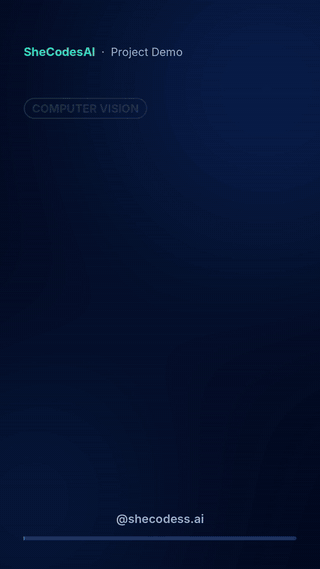
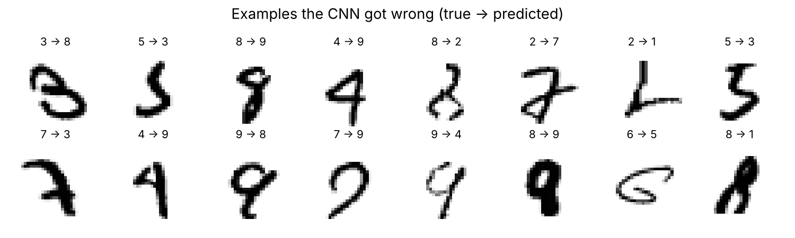
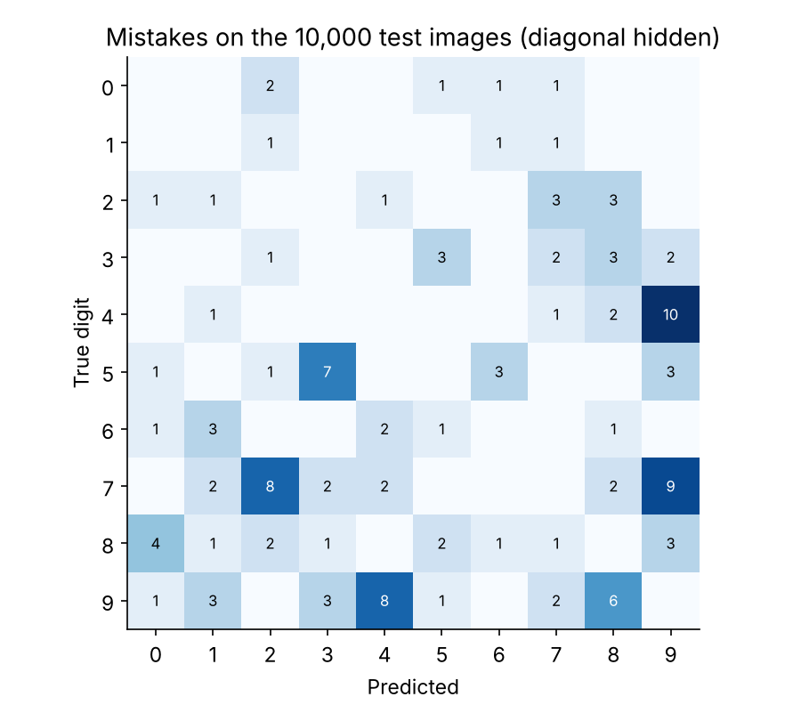
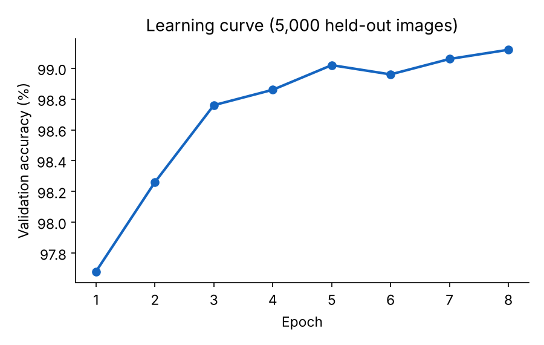
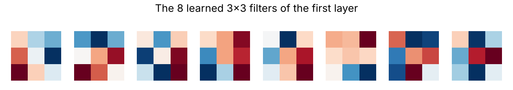

# Handwritten Digit Recognition: a CNN from Scratch

<p align="center"><a href="https://abbasisarah.github.io/assets/videos/demo-handwritten-digit-cnn.mp4"></a><br><sub>17-second demo. Click for the video with sound.</sub></p>

A convolutional neural network written in **plain NumPy**, with no TensorFlow or PyTorch. Every layer's forward and backward pass is hand-written and numerically gradient-checked. It recognises handwritten digits with **98.71% accuracy** on the 10,000 MNIST test images.

**Live demo:** https://abbasisarah.github.io/handwritten-digit-cnn/ (draw a digit and the trained network reads it in your browser).



## Results

| | |
|---|---|
| Test accuracy | **98.71%** (129 errors out of 10,000) |
| Parameters | 52,138 |
| Training time | ~4 minutes on a laptop CPU (8 epochs) |
| Easiest digit | 1: 99.74% correct |
| Hardest digits | 7 (97.57%) and 9 (97.62%) |

The most common mistakes are **4 → 9** (10 times), **7 → 9** (9), **9 → 4** (8) and **7 → 2** (8). These are shapes that differ by a single stroke, and some of them would puzzle a person too (see the examples above).

| | |
|---|---|
|  |  |

The model reached 97.7% validation accuracy after one epoch and 99.1% after eight. Validation used 5,000 training images held out from training; the test set was used only once, for the final number.

## Architecture

```
input 28×28
Conv 3×3, 8 filters  + ReLU + MaxPool 2×2   → 8 × 14 × 14
Conv 3×3, 16 filters + ReLU + MaxPool 2×2   → 16 × 7 × 7
Flatten (784) → Dense 64 + ReLU → Dropout 0.25 → Dense 10 → softmax
```

- **Convolution as matrix multiplication (im2col):** each 3×3 patch becomes a row, so a whole layer runs as one fast NumPy matrix product.
- **Training:** Adam optimiser (learning rate 0.001, decayed ×0.75 per epoch), batches of 64, cross-entropy loss, and random shifts of up to 2 pixels as data augmentation.
- **Verified:** `tests/test_cnn2d.py` compares every gradient with a finite-difference estimate.
- **First-layer filters:** the network learned edge and stroke detectors on its own.



## Browser demo

`docs/` holds a self-contained web page. The trained weights are exported to JavaScript, and the same forward pass runs in the browser; it gives the same answer as Python on every test digit checked. Your drawing goes through the same preprocessing as MNIST: crop the ink, scale it to 20 pixels, and centre it by centre of mass in a 28×28 box.

## Run it

```bash
pip install -r requirements.txt
python tests/test_cnn2d.py     # gradient check
python train.py                # train + evaluate + export demo weights (~4 min)
python predict.py my_digit.png # recognise a digit in your own photo or scan
```

## Project structure

```
├── data/              MNIST (original IDX files)
├── src/cnn2d.py       layers, network, Adam training loop, data loading
├── train.py           training, evaluation, figures, demo export
├── predict.py         classify your own image
├── tests/             numerical gradient check
├── docs/              browser demo (GitHub Pages)
├── models/            trained weights
└── results/           metrics.json and figures
```

## Data and licence

MNIST is by Y. LeCun, C. Cortes and C. J. C. Burges. The code is released under the MIT licence.
